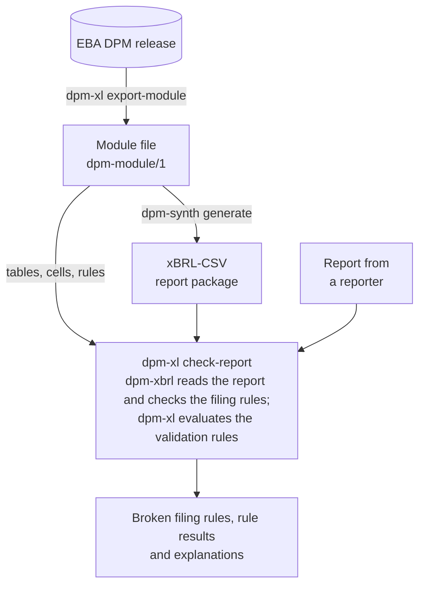

# The dpm toolkit

Three Python packages for EBA supervisory reports. Each is documented on its
own site and can be used alone; dpm-synth builds on the other two.

--8<-- "docs/.snippets/toolkit-cards.md"

## Start here by goal

### Check a report before submission

```bash
pip install "dpm-xl[xbrl]"
dpm-xbrl inspect report.zip
dpm-xl check-report module.json report.zip
```

You need the report, as an xBRL-CSV report package or an XBRL-XML file.
`dpm-xbrl inspect` checks the EBA filing rules and needs nothing else.
`dpm-xl check-report` also evaluates the module's validation rules, so it
needs the module file of the report's module (see
[export a module](#export-a-module-from-an-eba-dpm-release)); for an
XBRL-XML report it also needs the EBA taxonomy packages of its entry
point, given with `--taxonomy-package` (repeatable). Read
[check the filing rules](https://luukhopman.github.io/dpm-xbrl/guides/check-filing-rules/)
and [`dpm-xl check-report`](https://luukhopman.github.io/dpm-xl/reference/cli/#dpm-xl-check-report).

### Evaluate rules in Python

```bash
pip install dpm-xl
```

You need the values to check, held in memory or behind a small provider
class that you write over your own storage; dpm-xl has no dependencies.
Read dpm-xl's
[getting started](https://luukhopman.github.io/dpm-xl/getting-started/),
then [connect your data](https://luukhopman.github.io/dpm-xl/guides/provider/).

### Export a module from an EBA DPM release

```bash
pip install dpm-xl
dpm-xl export-module "DPM2 Database_v 4_4.zip" COREP_OF -o module.json
```

You need the EBA's DPM 2.0 database: the ZIP the EBA publishes, read with
[mdbtools](https://github.com/mdbtools/mdbtools), or the same database
converted to SQLite (about 350 MB), which needs nothing else. Read
[start from an EBA DPM release](https://luukhopman.github.io/dpm-xl/guides/from-a-dpm-release/).

### Generate test reports

```bash
pip install dpm-synth
dpm-synth generate module.json -o report.zip --seed 7
```

You need a module file, exported as above or written by hand; no real
data. Read dpm-synth's
[getting started](https://luukhopman.github.io/dpm-synth/getting-started/).

## Which versions work together

Use the latest release of each package. dpm-synth reads the module files
that dpm-xl's `export-module` writes, and dpm-xl's `check-report` needs its
`xbrl` extra, which installs a compatible dpm-xbrl:
`pip install "dpm-xl[xbrl]"`.

## How a report flows through the toolkit



1. A DPM release defines each module's tables, cells and validation rules.
   [`dpm-xl export-module`](https://luukhopman.github.io/dpm-xl/guides/from-a-dpm-release/)
   reads the EBA's DPM database and writes one module as a
   [module file](https://luukhopman.github.io/dpm-xl/reference/module-file/):
   one JSON file with the module's tables, cells, datapoints and rules.
2. Both dpm-xl and dpm-synth read the module file as it is: dpm-xl to
   check reports, dpm-synth to generate them. dpm-synth calls it its
   [template file](https://luukhopman.github.io/dpm-synth/reference/template-format/).
3. `dpm-synth generate` fills every cell with a plausible value, repairs
   the values until the rules pass, and writes an xBRL-CSV report package
   with dpm-xbrl.
4. dpm-xbrl reads that package, or any real report in xBRL-CSV or
   XBRL-XML, into facts, and records the EBA filing rules the file breaks.
5. dpm-xl places those facts in the module's tables with
   `dpmxl.xbrl.ReportProvider` (the `xbrl` extra), evaluates the module's
   DPM-XL rules and explains each failure with the values and tolerances
   involved.

`dpm-xl check-report MODULE REPORT` runs steps 4 and 5 in one command. The
[toolkit tour](https://luukhopman.github.io/dpm-xl/guides/toolkit-tour/)
runs every step in Python on one small report.

## Which package for which task

| Task | Package |
| --- | --- |
| Read the facts of a report in Python, or convert it between xBRL-CSV and XBRL-XML | [dpm-xbrl] |
| Check that a report file follows the EBA filing rules before it is sent | [dpm-xbrl] |
| Check that a DPM-XL expression parses, and find what it refers to | [dpm-xl] |
| Evaluate the EBA validation rules on the values of a report | [dpm-xl], with the facts from [dpm-xbrl] |
| Check a report against its module, filing rules and validation rules, in one command | `dpm-xl check-report`, from [dpm-xl] with the `xbrl` extra |
| Export a module of an EBA DPM release as a module file | `dpm-xl export-module`, from [dpm-xl] |
| Produce realistic test reports for a loader, warehouse or validator, without real data | [dpm-synth] |

## What the packages share

- Python 3.11 or newer. dpm-xl and dpm-xbrl use only the standard library
  at run time; dpm-synth depends on the other two.
- Import names without the hyphen: `dpmxl`, `dpmxbrl` and `dpmsynth`.
- Exit statuses: 0 when nothing is wrong, 1 when the input was read and
  has problems, 2 for a usage error and 3 for unreadable or invalid input.
  Where a command takes `--fail-on`, the default is `error`. Each site's
  CLI reference lists the exact conditions.
- The same [glossary](reference/glossary.md), shown as tooltips on every
  page of the three sites.
- A page on the standards each package implements, with the versions,
  what is checked, and how it is tested.
- Independence: none of the packages is affiliated with or endorsed by the
  European Banking Authority.
