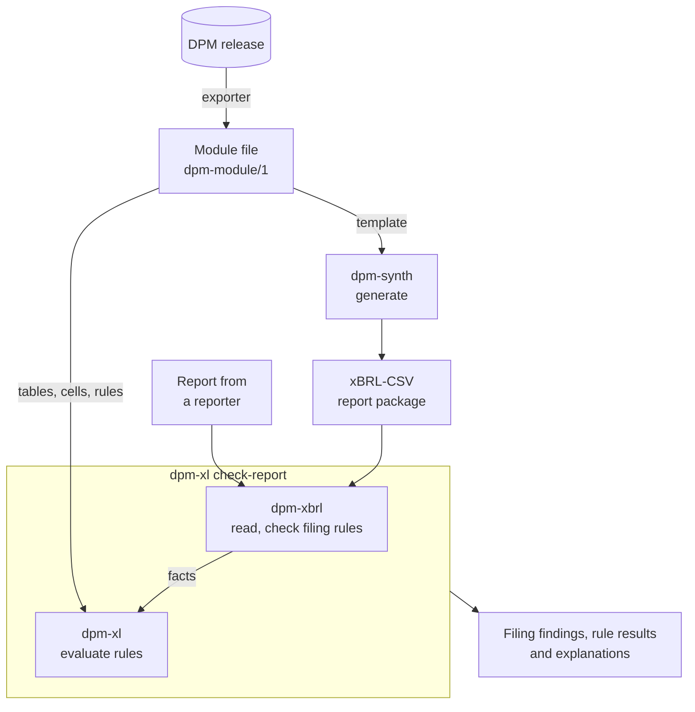

# The dpm toolkit

Three Python packages for EBA supervisory reports. Each is documented on its
own site and can be used alone; dpm-synth builds on the other two.

--8<-- "docs/.snippets/toolkit-cards.md"

## How a report flows through the toolkit

1. A DPM release defines each module's tables, cells and validation rules.
   None of the three packages reads the DPM database: an exporter, a script
   of your own over the release, writes one module as a
   [module file](https://luukhopman.github.io/dpm-xl/reference/module-file/),
   a JSON document with the module's tables, cells, datapoints and rules.
2. One module file serves dpm-xl and dpm-synth. dpm-xl reads it in the
   `dpm-module/1` format, and dpm-synth reads the same fields as its
   [template](https://luukhopman.github.io/dpm-synth/reference/template-format/),
   in the `dpm-synth-template/1` format, which dpm-xl reads too.
3. `dpm-synth generate` fills every cell of the template with a plausible
   value, repairs the values until the rules pass, and writes an xBRL-CSV
   report package with dpm-xbrl.
4. dpm-xbrl reads that package, or any real report in xBRL-CSV or
   XBRL-XML, into facts, and records the EBA filing rules the file breaks.
5. dpm-xl places those facts in the module's tables with
   `dpmxl.xbrl.ReportProvider` (the `xbrl` extra), evaluates the module's
   DPM-XL rules and explains each failure with the values and tolerances
   involved.

`dpm-xl check-report MODULE REPORT` runs steps 4 and 5 in one command. The
[toolkit tour](https://luukhopman.github.io/dpm-xl/guides/toolkit-tour/)
runs every step on one small report, with code you can copy.

## Which package for which task

| Task | Package |
| --- | --- |
| Read the facts of a report in Python, or convert it between xBRL-CSV and XBRL-XML | [dpm-xbrl] |
| Check that a report file follows the EBA filing rules before it is sent | [dpm-xbrl] |
| Check that a DPM-XL expression parses, and find what it refers to | [dpm-xl] |
| Evaluate the EBA validation rules on the values of a report | [dpm-xl], with the facts from [dpm-xbrl] |
| Check a report against its module, filing rules and validation rules, in one command | `dpm-xl check-report`, from [dpm-xl] with the `xbrl` extra |
| Produce realistic test reports for a loader, warehouse or validator, without real data | [dpm-synth] |

## What the packages share

- Python 3.11 or newer. dpm-xl and dpm-xbrl use only the standard library
  at run time; dpm-synth depends on the other two.
- Import names without the hyphen: `dpmxl`, `dpmxbrl` and `dpmsynth`.
- The same [glossary](reference/glossary.md), shown as tooltips on every
  page of the three sites.
- A page on the standards each package implements, with the versions,
  what is checked, and how it is tested.
- Independence: none of the packages is affiliated with or endorsed by the
  European Banking Authority.
